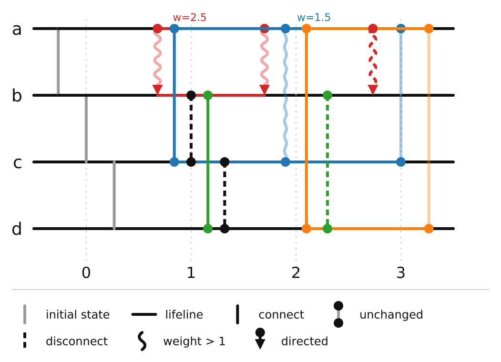
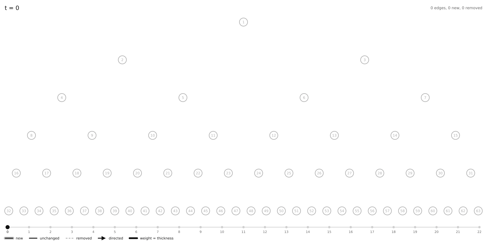
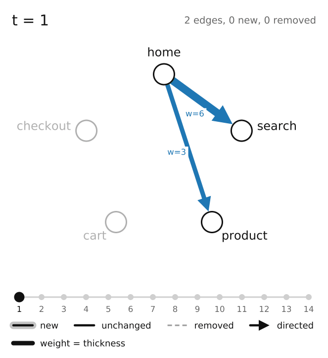
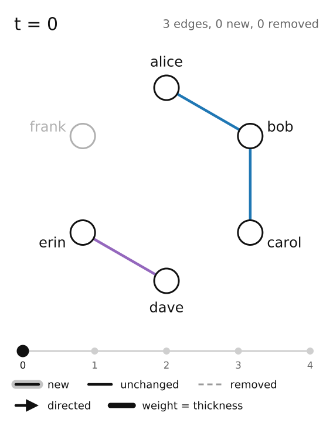
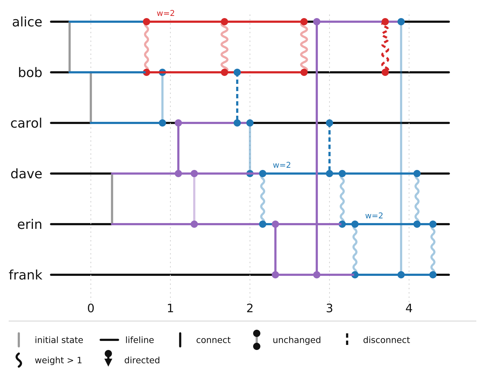
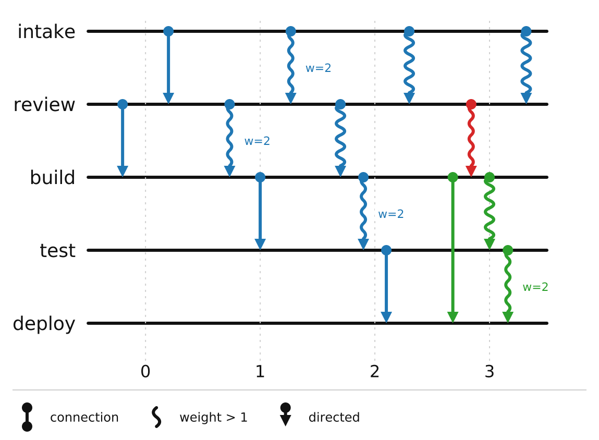

<p align="center">
  
</p>

<h1 align="center">temporal-graph</h1>

<p align="center">
  Model graphs that evolve over time, compute on them, and render them as SVG, PNG or animated GIF.
</p>

<p align="center">
  
  
  
</p>

<p align="center">
  <b>Giuliano Crenna</b><br>
  Facultad de Ciencias Exactas, Ingeniería y Agrimensura, Universidad Nacional de Rosario<br>
  <a href="mailto:giulicrenna@fceia.unr.edu.ar">giulicrenna@fceia.unr.edu.ar</a>
</p>

---

A temporal graph is a graph whose edges exist only at certain instants. This
library stores one snapshot per instant and offers three things on top:

- **Visualization.** Timeline charts in two modes and animated node-link
  views, written natively as SVG, PNG and GIF. There is no matplotlib,
  cairo or Pillow underneath.
- **Algorithms.** Journeys (time-respecting paths), temporal distance and
  diameter, connectivity metrics, the temporal Menger theorems, information
  dissemination, temporal design, periodic availability, random temporal
  graphs and exact solvers for temporal matching, exploration and TSP.
- **Data tools.** Graph transformations, per-snapshot analysis, and JSON,
  CSV and GEXF export.

Every algorithm is checked against the worked examples of the notes
[*Grafos temporales: una introducción desde la perspectiva algorítmica*](grafos_temporales.pdf)
and cross-checked against brute force on random graphs.



## Contents

- [Install](#install)
- [Quick start](#quick-start)
- [Visualization](#visualization)
- [Animating the evolution (GIF)](#animating-the-evolution-gif)
- [Algorithms](#algorithms)
- [Data tools](#data-tools)
- [Examples](#examples)
- [Behavior notes](#behavior-notes)
- [Development](#development)
- [Author](#author)
- [Citing](#citing)
- [License](#license)

## Install

```bash
pip install temporal-graph
```

From source:

```bash
pip install -e ".[dev]"
```

## Quick start

```python
from temporal_graph import Edge, TemporalGraph, animate, journeys, render

g = TemporalGraph(nodes=["a", "b", "c", "d"])
g.add_snapshot(0, [Edge("a", "b"), Edge("b", "c"), Edge("c", "d")])
g.add_snapshot(1, [
    Edge("a", "b", directed=True, weight=2.5, color="#d62728"),
    Edge("a", "c", color="#1f77b4"),
])
g.add_snapshot(2, [Edge("a", "c")])

render(g, mode="decisions").savefig("decisions.png")   # or .svg
animate(g).save("evolution.gif")
journeys.earliest_arrival(g, "d")                      # who hears from d, and when
```

## Visualization

### Modes

Both modes share one layout: a horizontal lifeline per node, time on the
x-axis. Every figure embeds its own legend.

| Mode          | Shows |
|---------------|-------|
| `connections` | A full snapshot per timestep: each active edge is a vertical line with a dot per end. |
| `decisions`   | When edges appear and disappear: lifelines, solid `connect` / dashed `disconnect` marks, and faded connections for edges that carry on unchanged. |

### Edge properties

| Property        | Effect |
|-----------------|--------|
| `directed=True` | Arrowhead at the `v` end. |
| `weight > 1.0`  | Sinusoidal "snake" line whose amplitude grows with the weight; a `w=` label marks the first occurrence. |
| `color="..."`   | Any CSS color; applied to the line, dots and arrowhead. |

Edge identity is the unordered endpoint pair: `Edge("a", "b")` and
`Edge("b", "a")` are the same edge. Direction, weight and color may change
between snapshots without creating a new edge.

### Saving figures

`render(graph, mode)` returns a `Figure`:

| Member | Purpose |
|--------|---------|
| `savefig(path, format=None, scale=2.0)` | Write `.svg` or `.png`; returns the absolute path. `scale` is pixels per SVG unit and only affects PNG. |
| `to_svg()` | The SVG document as a string. |
| `to_png_bytes(scale=2.0)` | PNG file contents, e.g. to upload or embed without touching disk. |
| `width`, `height` | Size in SVG units. |

In Jupyter a `Figure` displays inline as SVG. `render(graph, mode, path)` still
works and returns the written path.

PNG output uses a built-in anti-aliasing rasterizer and an embedded copy of
the DejaVu Sans outlines (see [THIRD_PARTY_NOTICES.md](THIRD_PARTY_NOTICES.md)).
A typical graph renders in a fraction of a second. Very large ones, thousands
of pixels per side, take seconds, so lower `scale` if needed. Colors may be
hex, `rgb()` / `rgba()` or any CSS color name; an unsupported color raises
`ValueError` when saving PNG.

## Animating the evolution (GIF)

`animate(graph)` builds a node-link view with one frame per timestep and saves
it as an animated GIF, also natively:

```python
from temporal_graph import animate

anim = animate(g, frame_duration=800, loop=0)   # ms per frame; 0 = loop forever
anim.save("evolution.gif")                      # scale=1.5 pixels per unit
anim.frames[2].savefig("t2.png")                # every frame is a Figure
```

In each frame:

| Glyph | Meaning |
|-------|---------|
| Line with a soft halo | Edge that appeared at this timestep |
| Plain line | Edge that carries on from the previous timestep |
| Dashed grey line | Edge that disappeared at this timestep |
| Arrowhead | Directed edge |
| Thickness, `w=` label | Weight |
| Grey node | Node without edges at this timestep |

A header shows the timestep and a change summary, and a timeline bar at the
bottom marks progress. `Animation.to_gif_bytes()` returns the file contents.

Nodes sit on a fixed circle by default. Pass `positions={node: (x, y)}` (any
unit, y pointing down) to use your own layout, e.g. a hierarchy for a tree.
Coordinates are scaled so that the two closest nodes do not overlap. Short
labels are drawn inside the nodes and longer ones below.

<p align="center">
  
</p>

<p align="center">
  
  
</p>

## Algorithms

Timesteps are *instants*: a snapshot at `t` lists the edges available at `t`,
and unrecorded instants have no edges. A **journey** crosses edges at
strictly increasing instants (`strict=False` allows equal instants, for
chained instantaneous contacts). Directed edges are one-way.

```python
from temporal_graph import TemporalGraph, connectivity, flows, journeys

g = TemporalGraph.from_time_edges(
    ["u1", "u2", "u3", "u4", "u5"],
    [("u1", "u2", 5), ("u1", "u3", 1), ("u2", "u3", 2), ("u2", "u4", 6),
     ("u2", "u5", 3), ("u3", "u4", 4), ("u4", "u5", 7)],
)
journeys.earliest_arrival(g, "u1", start=0)     # {'u1': 0, 'u3': 1, 'u2': 2, 'u5': 3, 'u4': 4}
journeys.foremost_journey(g, "u1", "u5")        # u1 -1-> u3 -2-> u2 -3-> u5
flows.max_out_disjoint_journeys(g, "u1", "u5")  # 2
```

| Module | Contents | Cost |
|--------|----------|------|
| `TemporalGraph` | `time_edges()`, `labels(u, v)` (λ(e)), `age` (α), `label_count` (\|λ\|), `from_time_edges()` | |
| `expansion` | `static_expansion()`: time-unrolled DAG, with or without waiting arcs | n(α+1) nodes |
| `journeys` | `earliest_arrival`, `foremost_journey`, `latest_departure`, `fastest_journey`, `shortest_journey`, `enumerate_journeys`, `reachable`, `reachability`, `is_temporally_connected`, `temporal_distance` | foremost O(n + \|λ\|); shortest O(n·\|λ\|); fastest O(deg·\|λ\|) |
| `connectivity` | `temporal_diameter` (d), `connectivity_time` (ct), `outgoing_influence_time` (oit), `future_set_sizes`, `is_continuously_connected`, `is_f_connected`, `vertex_connectivity_at`, `is_interval_connected` | d, oit: n·α foremost searches |
| `flows` | Temporal Menger: `max_out_disjoint_journeys` / `min_departure_separator` (any graph); `max_edge_disjoint_journeys` / `min_edge_separator` (single labels); `max_node_disjoint_journeys` (exact, NP-hard) | max-flow on the expansion |
| `dissemination` | `flooding_times`, `k_token_dissemination` (online token forwarding, pluggable policy), `harmonic_potential` | |
| `design` | `dag_labeling` (temporality 1), `directed_ring_labeling` ({i, n+i}), `reachability_labeling` (≤ 2 labels, strongly connected digraphs), `preserves_all_paths`, `preserves_reachability`, `temporality`, `temporal_cost` | |
| `periodic` | Linear availability `a·x + b`: `common_instants`, `edges_coincide`, `solve_congruences` (generalized CRT), `linear_earliest_arrival` (no time materialization), `linear_availability_graph` | O(m log n) foremost |
| `generators` | `moving_star`, `alternating_matchings`, `soifer_graph`, `rotating_center_star` | |
| `random_models` | `random_temporal_graph(n, r, seed)`, `path_journey_probability`, `expected_journey_count`, `foremost_within_two_probability` | |
| `classic` | Exact small-instance solvers: `max_temporal_matching`, `temporal_exploration`, `temporal_tsp` | exponential |

The test suite reproduces these results from the notes:

- the journeys of figure 2;
- the static-expansion sizes;
- the Menger examples;
- the table 4 metrics;
- the labelings of section 7;
- the periodic coincidences;
- formulas (5) to (7);
- the exploration times of figure 7.

It also cross-checks against brute force on random graphs: BFS on the static
expansion, exhaustive journey enumeration and exhaustive disjoint-journey
search.

## Data tools

| Module | Contents |
|--------|----------|
| `utils` | `from_edge_list(nodes, {t: [(u, v), ...]})`, `snapshot_diff(graph, t1, t2)`, `filter_edges(graph, predicate)`, `subgraph(graph, nodes)` |
| `analysis` | `degree_timeline(graph, node)`, `connected_components_at(graph, t)`, `edge_persistence(graph)`, `is_temporally_acyclic(graph)` |
| `exporters` | `to_json` / `from_json` (lossless round trip), `to_csv`, `to_gexf` (dynamic GEXF for Gephi) |

Core API of `TemporalGraph`:

| Name | Purpose |
|------|---------|
| `Edge(u, v, directed=False, weight=1.0, color=None)` | Immutable, validated edge. |
| `TemporalGraph(nodes)` | Container of per-timestep snapshots. |
| `add_snapshot(t, edges)` | Record (or replace) the edges active at `t`. |
| `edges_at(t)`, `edge_at(t, key)`, `snapshots()`, `timesteps`, `nodes` | Read access. |
| `change_events()` | `(t, "connect" \| "disconnect", key)` between consecutive snapshots. |
| `edge_intervals()` | Half-open `(start, end)` presence intervals per edge. |

```python
from temporal_graph import analysis, exporters, utils

utils.snapshot_diff(g, 0, 1)           # (added, removed)
analysis.degree_timeline(g, "a")       # {0: 1, 1: 2, 2: 1}
exporters.to_gexf(g, "graph.gexf")
```

## Examples

Every script in [examples/](examples/) runs from the repo root and writes its
output into `output/`.

| Script | Shows | Output |
|--------|-------|--------|
| [example.py](examples/example.py) | Direction, weight, color and reconnection in one graph. | [connections](output/example_connections.svg), [decisions](output/example_decisions.svg) |
| [social_network.py](examples/social_network.py) | Friendships that strengthen, form and fade; weight and color as relationship strength. | [connections](output/social_network_connections.svg), [decisions](output/social_network_decisions.svg) |
| [process_flow.py](examples/process_flow.py) | Directed handoffs in a delivery pipeline, plus a per-snapshot acyclicity check. | [connections](output/process_flow_connections.svg), [decisions](output/process_flow_decisions.svg) |
| [custom_colors.py](examples/custom_colors.py) | Color as health and weight as traffic on the same edges over time. | [connections](output/custom_colors_connections.svg), [decisions](output/custom_colors_decisions.svg) |
| [binary_tree.py](examples/binary_tree.py) | A 63-node binary tree built breadth-first and pruned back, with a hierarchical `positions` layout. Takes about 20 s. | [binary_tree.gif](output/binary_tree.gif), [full tree](output/binary_tree_full.png), [decisions](output/binary_tree_decisions.png) |
| [markov_chain.py](examples/markov_chain.py) | A non-reversible Markov chain in two parts. First, a simulated trajectory whose foremost arrivals are the first hitting times, checked against the exact `h = 1 + P h`. Second, the exact net probability flow converging to the stationary cycle current. | [trajectory](output/markov_trajectory_connections.png), [markov_flow.gif](output/markov_flow.gif), [stationary flow](output/markov_flow_stationary.png) |
| [physics/harmonic_chain.py](examples/physics/harmonic_chain.py) | Sound in a chain of masses and springs. Foremost journeys over energetic springs track the wavefront, which matches the exact Bessel solution, and recover `c = a sqrt(k/m)` within 2 %. See [examples/physics](examples/physics/README.md). | [light cone](output/physics/harmonic_chain_connections.svg), [harmonic_chain.gif](output/physics/harmonic_chain.gif) |
| [physics/hard_disk_gas.py](examples/physics/hard_disk_gas.py) | Collisions of a hard-disk gas as a contact network. The collision rate is checked against Enskog theory, speeds against Maxwell-Boltzmann, and causal spreading against a well-mixed SI process. | printed results, [cascade](output/physics/hard_disk_cascade_connections.svg) |
| [temporal_algorithms.py](examples/temporal_algorithms.py) | Journeys, metrics, Menger, labelings, periodic and random models, exact classic problems on the notes' examples. | printed results, `moving_star.gif` |
| [animation.py](examples/animation.py) | Evolution of the social network and the pipeline as animated GIFs. | [social_network.gif](output/social_network.gif), [process_flow.gif](output/process_flow.gif) |
| [analysis_and_export.py](examples/analysis_and_export.py) | Degree, components, persistence, diff, subgraph, and JSON / CSV / GEXF export. | printed metrics, `network.json`, `network.csv`, `network.gexf` |

Social network, `decisions` mode:



Delivery pipeline, `connections` mode:



## Behavior notes

* Self-loops and undeclared nodes are rejected (`ValueError`).
* Duplicate edges within one snapshot are deduplicated; the first one wins.
* An edge absent from a snapshot is disconnected; it must be declared again
  to reappear.
* Because edge identity ignores direction, `u -> v` and `v -> u` cannot both
  be present at the same instant.
* When several edges act at the same timestep they are placed in sub-lanes
  inside that timestep's column.

## Development

```bash
pip install -e ".[dev]"
ruff check temporal_graph tests
mypy temporal_graph
pytest --cov=temporal_graph
```

See [CONTRIBUTING.md](CONTRIBUTING.md), [CHANGELOG.md](CHANGELOG.md) and
[PUBLISHING.md](PUBLISHING.md).

## Author

**Giuliano Crenna**
Facultad de Ciencias Exactas, Ingeniería y Agrimensura
Universidad Nacional de Rosario
[giulicrenna@fceia.unr.edu.ar](mailto:giulicrenna@fceia.unr.edu.ar)

Questions, bug reports and contributions are welcome by email or through the
repository's issues.

## Citing

If you use this library in academic work, please cite it together with the
notes its algorithms follow:

```bibtex
@software{crenna_temporal_graph,
  author      = {Crenna, Giuliano},
  title       = {temporal-graph: modelling, computing on and rendering temporal graphs},
  year        = {2026},
  institution = {Facultad de Ciencias Exactas, Ingenier{\'\i}a y Agrimensura, Universidad Nacional de Rosario}
}

@misc{crenna_grafos_temporales,
  author = {Crenna, Giuliano},
  title  = {Grafos temporales: una introducci{\'o}n desde la perspectiva algor{\'\i}tmica},
  year   = {2026},
  month  = oct,
  note   = {Facultad de Ciencias Exactas, Ingenier{\'\i}a y Agrimensura, Universidad Nacional de Rosario}
}
```

## License

MIT, see [LICENSE](LICENSE). The embedded DejaVu Sans outlines are under the
Bitstream Vera license, see [THIRD_PARTY_NOTICES.md](THIRD_PARTY_NOTICES.md).
