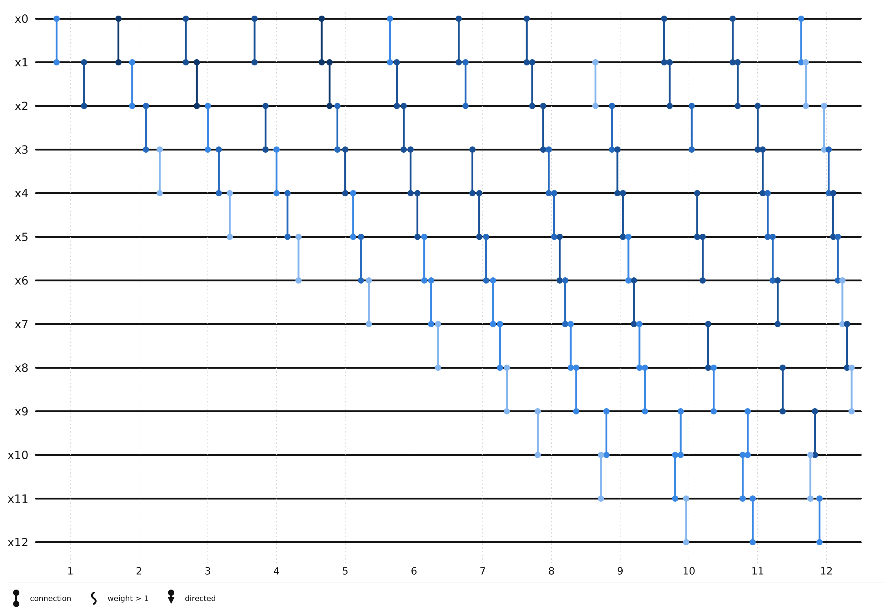
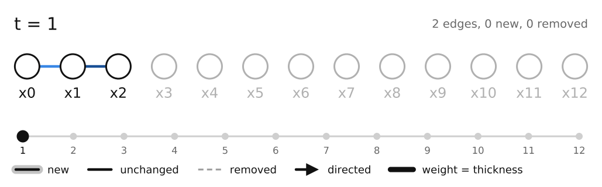
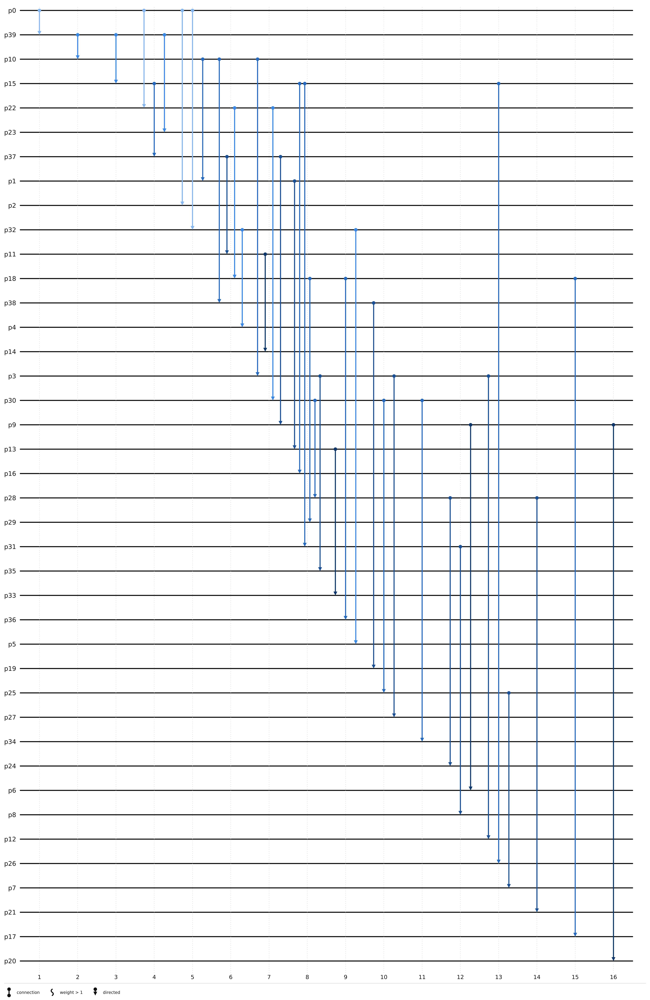

# Physics examples

Two simulations whose interactions are turned into temporal graphs. In each
one the journeys of the graph answer a physical question, and the script
checks the answer against theory. Both run from the repo root, use only the
standard library, and write into `output/physics/`.

| Script | System | Temporal graph | Checked against |
|--------|--------|----------------|-----------------|
| [harmonic_chain.py](harmonic_chain.py) | Masses and springs, central mass displaced | Spring `(n, n+1)` at instant `t` while it holds ≥ 0.1 % of the energy | Exact Bessel solution, speed of sound `c = a sqrt(k/m)` |
| [hard_disk_gas.py](hard_disk_gas.py) | 40 hard disks in a periodic box, exact event-driven dynamics | One edge per collision, binned into instants of 0.02 | Enskog collision frequency, Maxwell-Boltzmann, stochastic SI spreading |

```bash
python examples/physics/harmonic_chain.py   # about 4 s
python examples/physics/hard_disk_gas.py    # about 9 s
```

## Sound in a harmonic chain

A chain of masses `m` joined by springs `k` of length `a` obeys
`m u''_n = k (u_(n+1) - 2 u_n + u_(n-1))`. Displacing the central mass by 1
and releasing it gives `u_n(t) = J_2n(2 ω0 t)` with `ω0 = sqrt(k/m)`. Since
`J_2n(x)` is exponentially small for `x < 2n`, the energy moves inside the
light cone `|n| a ≤ c t` with `c = a ω0`.

The chain is sampled every 0.25 time units, and a spring is an edge while it
stores at least 0.1 % of the initial energy. A journey from site 0 is then a
path the energy can follow, and the foremost arrival at site `n` is the
arrival time of the wavefront.

Output with `k = m = a = 1`:

```text
[1] t = 26.0: max |u_n - J_2n(2 w0 t)| = 9.3e-05, relative energy drift = -4.5e-05
[2] time edges: simulated 1243, exact 1243, shared 1243; foremost arrivals identical: True
[3] site  arrival  light cone n*a/c  apparent speed n*a/t
       5     3.00              5.00                 1.667
       9     7.00              9.00                 1.286
      13    11.00             13.00                 1.182
      17    15.25             17.00                 1.115
      19    17.25             19.00                 1.101
    fitted front speed 0.980 (c = 1.000); lead over the light cone for n >= 5: 1.75 to 2.00
[4] mass   c theory   c fitted   ratio
     0.5      1.414      1.396   0.987
     1.0      1.000      0.980   0.980
     2.0      0.707      0.699   0.988
     4.0      0.500      0.494   0.987
```

1. The velocity Verlet integrator reproduces the Bessel solution to 1e-4 and
   conserves energy to 5e-5.
2. The temporal graph built from the simulation and the one built from the
   exact solution share all 1243 time edges, so every journey is the same.
3. Arrival times grow linearly with distance. The exponential tail ahead of
   the cone crosses the threshold about 2 time units early, but that lead
   does not grow with distance, so `n a / t → c`. A linear fit gives 0.98 c.
4. The fitted speed follows `1 / sqrt(m)` within 2 % over a factor 8 in mass.

`harmonic_chain_connections.png` shows sites 0 to 12 with one column per time
unit. The edges fill a cone whose edge is the wavefront. Darker blue means
more stored energy, in steps of 0.1 %, 0.3 %, 1 %, 3 % and 10 %.





## Collisions in a hard-disk gas

Forty disks of diameter `σ = 1` at packing fraction `η = 0.2` start on a
lattice with equal speeds and random directions. Between collisions they
move in straight lines, so the event-driven simulation is exact up to
rounding. Every collision becomes an edge at its instant.

Output with `kT = m = 1`:

```text
[1] collision frequency per disk: measured 1.304, Enskog 1.287 (+1.3%), dilute Boltzmann 0.903
[2] <v^4>/<v^2>^2 averaged over 20 runs (equal speeds 1, Maxwell 2); mean free time 0.78
    t =  0.0 ( 0.0 free times): 1.000
    t =  1.0 ( 1.3 free times): 1.297
    t =  2.0 ( 2.6 free times): 1.521
    t =  4.0 ( 5.1 free times): 1.819
    t =  8.0 (10.3 free times): 1.926
    equilibrium, 8040 speeds pooled: 1.996
    speed range   measured   Rayleigh
    [0.0, 0.5)     0.125      0.118
    [0.5, 1.0)     0.268      0.276
    [1.0, 1.5)     0.271      0.282
    [1.5, 2.0)     0.202      0.189
    [2.0, 2.5)     0.089      0.091
    [2.5, 3.0)     0.036      0.033
    [3.0, inf)     0.010      0.011
[3] disks reached from one disk, mean over 360 sources x start instants
    time   real gas   shuffled partners   well-mixed theory
     1.0        2.9                 3.3                 3.5
     2.0        7.5                 9.0                 9.5
     3.0       15.4                18.4                19.1
     4.0       25.5                28.5                28.5
     6.0       37.2                37.8                37.9
    mean time to reach 20 disks: real 3.49, shuffled 3.20, well-mixed theory 3.14
```

1. **Collision frequency.** The number of time edges gives the collision
   frequency per disk. Enskog theory predicts
   `ν = 2 σ n sqrt(π kT/m) g(σ)` with Henderson's contact value
   `g(σ) = (1 - 7η/16) / (1 - η)²`. The measurement agrees within 1.3 %. The
   dilute Boltzmann value, without `g(σ)`, is 30 % too low.
2. **Maxwell-Boltzmann.** Collisions alone take the speeds from a single
   value to the 2D Maxwell (Rayleigh) distribution within about 10 mean free
   times. The ratio `<v^4>/<v^2>^2` goes from 1 to 2.
3. **Causal spreading.** Foremost journeys from a disk give the disks it
   could have influenced by each instant. A well-mixed gas would follow a
   stochastic SI process: with `k` disks reached, the next one comes at
   rate `ν k (N - k) / (N - 1)`, and half the gas is reached after
   `Σ 1/λ_k = 3.14` on average. If collision partners are reshuffled at the
   same instants, the graph matches that prediction within 2 %. The remaining
   gap comes from the width of the instants. The real gas is 11 % slower:
   collisions are local in space, and disks that just met tend to meet
   again, which wastes contacts on disks that are already reached.

`hard_disk_cascade_connections.png` shows the foremost-journey tree from
`p0`, starting at `t = 20`, on instants of 0.5. Each disk is drawn at the
collision that first reaches it, and disks are sorted by arrival. Darker blue
means more hops from `p0`.


